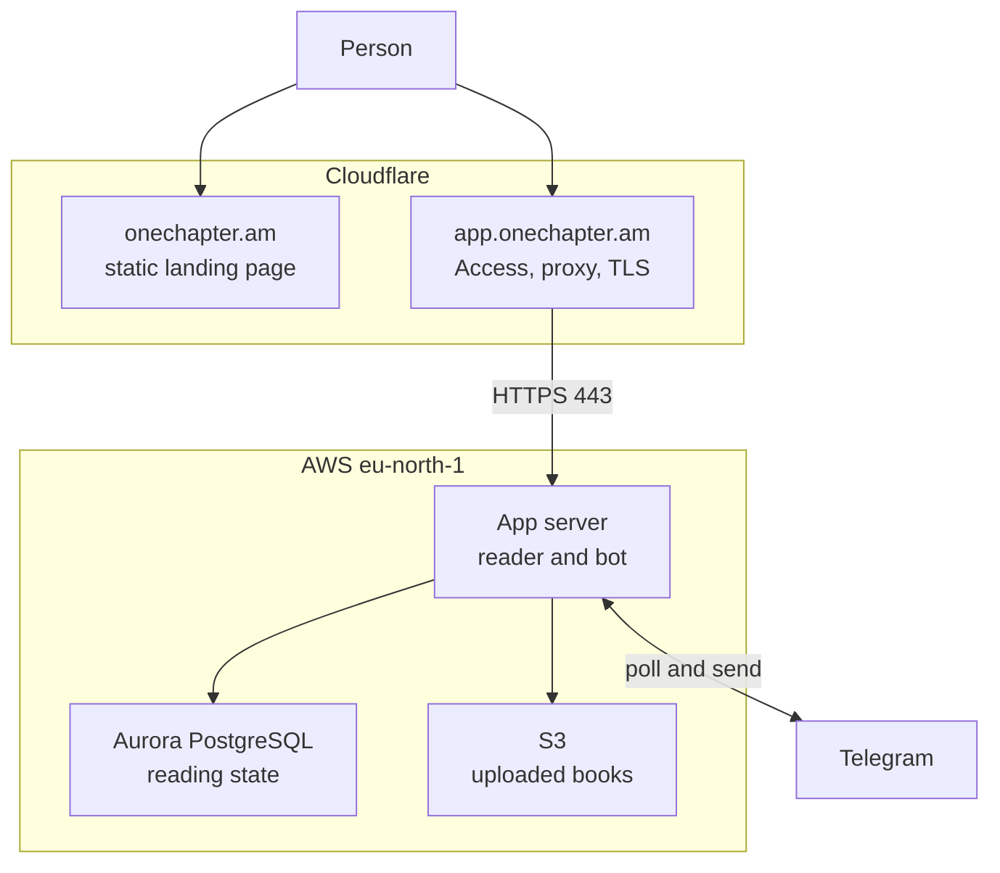
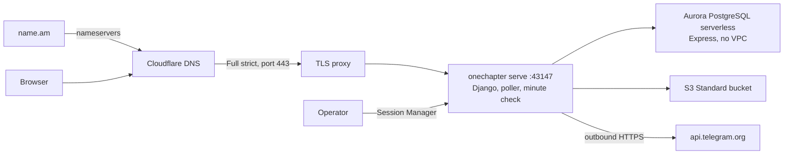
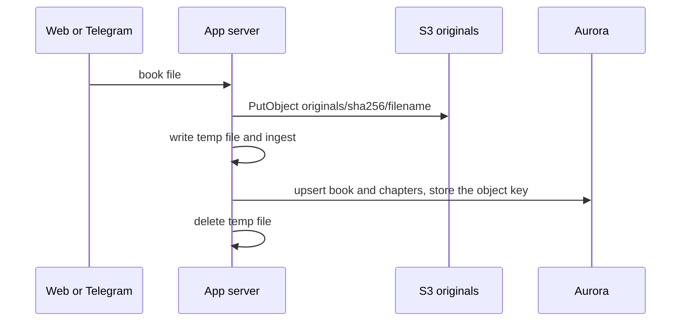
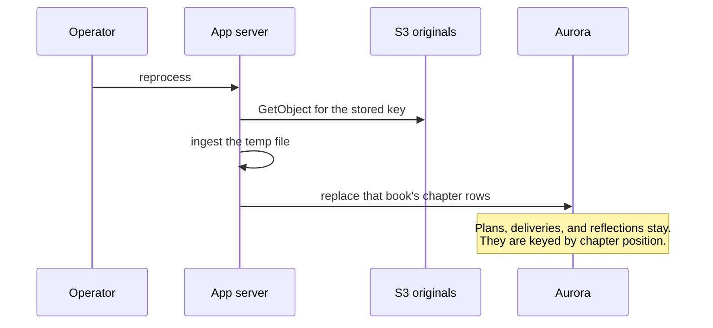

# Proposed architecture

Status: **Proposed**. These diagrams describe the deployment to review before implementation. The decisions are the ADRs in [../adr/README.md](../adr/README.md).

One Chapter stays a single Python process. Cloudflare is the public edge. AWS, in `eu-north-1` only, holds the reader, the bot, the reading database, and the original book files.

## System context

People read a public page at the apex. The reader and the operator tools are a second hostname. Telegram talks only to the app server.

The landing page does not call AWS. Seeded public-domain books stay in the git repository and are loaded by the app, not stored in S3.

## What each store holds

| Store | Holds | Does not hold |
| --- | --- | --- |
| Cloudflare static site | The public explanation of the practice | Reader state, book text, tokens |
| Aurora PostgreSQL | Books, chapters, readers, plans, deliveries, reflections, settings | Original MOBI, EPUB, or FB2 bytes |
| S3 `originals/` | One object per uploaded file, key `originals/{sha256}/{filename}` | Reading progress and notes |
| App server disk | The container, temp files during ingest | The only copy of anything that must survive a rebuild |

## Deployment

name.am remains the registrar. Cloudflare's nameservers are authoritative. The app server has a public address and no load balancer. The security group accepts 443 from Cloudflare's published IP ranges only.

Production Django settings: debug off, a real secret key, `ALLOWED_HOSTS` and CSRF limited to `https://app.onechapter.am`, and the proxy SSL header set. HTML is not cached at Cloudflare. `/static/` is.

## Upload and reprocess

The parser still reads a local file. S3 is the copy that remains after the temp file is deleted.

Reprocess is for a bad split or an empty chapter table. Restoring a day of reading, a note, or a "already sent" mark is an Aurora restore, not an S3 download.

## Delivery

The bot and the website share the process. Once a minute the process asks whether today's chapter is due and unsent. A restart later the same local day still sends it. A stop that lasts past local midnight misses that day.

A separate sender is deferred. If the morning message must survive the website being down, EventBridge Scheduler will call a Lambda that runs the same check. That Lambda is not part of the first deployment, and it is not a second server.

## Review notes

These are the choices worth challenging before implementation:

1. The reader is private via Cloudflare Access, not a new login. Access comes off only when Django grows its own authentication.
2. One EC2 instance is the compute. ECS Express Mode stays an alternative if its live price beats a single instance plus the time to patch it. The instance size waits on the live `eu-north-1` price so the credits last through 2027-05-06.
3. Aurora PostgreSQL serverless (Express) is the database. Aurora DSQL stays the alternative if idle cost becomes the reason to accept its narrower SQL dialect.
4. S3 holds originals only. Reprocessing can move notes onto a different chapter if the split positions change.
5. The first deployment does not add the Lambda sender. The bot runs on the app server.
