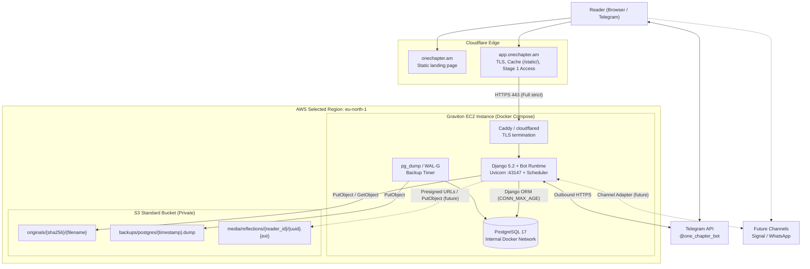
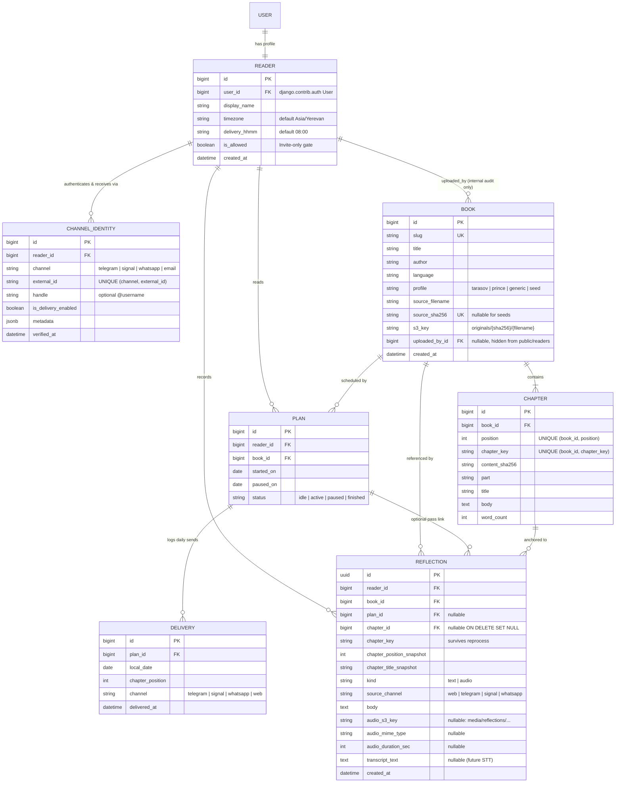
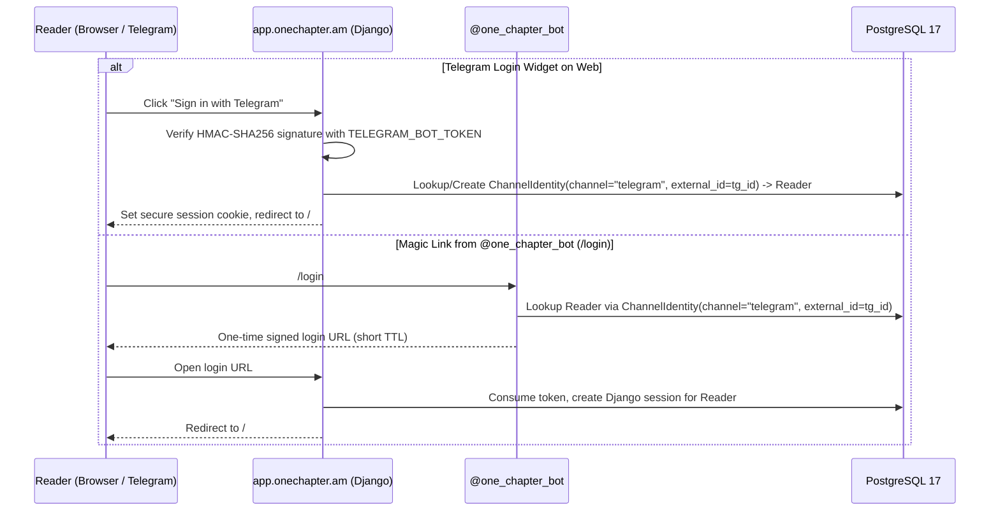
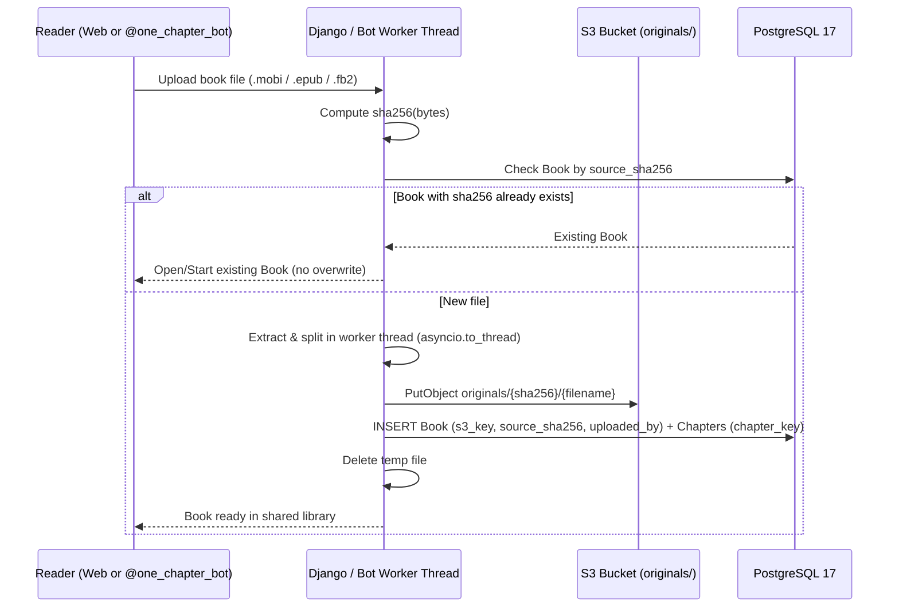
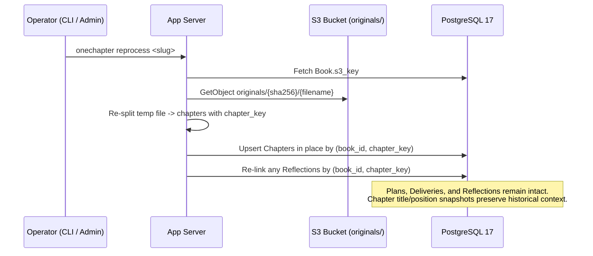

# Proposed Architecture

Status: **Proposed**. This document describes the target deployment, data model, identity architecture, and operational flows for One Chapter (`onechapter.am` and `@one_chapter_bot`). Individual decisions are recorded in [../adr/README.md](../adr/README.md).

One Chapter runs as a cohesive Docker Compose stack on a single Graviton EC2 instance in `eu-north-1`, behind Cloudflare at the edge, using **Django 5.2 ORM** with **PostgreSQL 17** on the host and a single private **S3 Standard** bucket in `eu-north-1` for durable storage (book originals, automated PostgreSQL backups, and future audio reflections).

---

## 1. System Context

Visitors read the public explanation of the practice at `onechapter.am`. The web reader and library live at `app.onechapter.am`. Readers interact with the shared Telegram bot `@one_chapter_bot` (with the data model ready to add Signal and WhatsApp channels later). Both web and bot resolve to the same canonical `Reader` account.

---

## 2. What Each Store Holds

| Store | Holds | Does Not Hold |
| --- | --- | --- |
| **Cloudflare Static Site** (`onechapter.am`) | Public explanation of the slow-reading practice, links to `@one_chapter_bot` and `app.onechapter.am` | Reader state, book text, credentials |
| **PostgreSQL 17** (`db` container on EBS `gp3`) | Users/Readers, `ChannelIdentity` links, books metadata, chapters (with `chapter_key`), reading plans, deliveries, reflections | Raw `.mobi`/`.epub`/`.fb2` binaries, raw audio blobs |
| **S3 `originals/`** | One immutable object per unique uploaded book file: `originals/{sha256}/{filename}` | Reading progress, notes |
| **S3 `backups/postgres/`** | Automated daily and pre-deploy compressed `pg_dump` / WAL archives (30-day retention) | Unencrypted public objects |
| **S3 `media/reflections/`** *(future)* | Voice/audio chapter reflections (`media/reflections/{reader_id}/{uuid}.{ext}`) served via short-lived Presigned URLs | Publicly listable files |
| **EC2 Ephemeral Disk (`/tmp`)** | Temporary scratch files during book ingestion or backup creation | Any state that lacks an S3 backup or original |

---

## 3. Domain Data Model (Django 5.2 ORM)

Instead of bypassing Django with raw SQLite queries, One Chapter uses standard Django 5.2 models and migrations ([ADR 0004](../adr/0004-postgresql-and-django-orm.md), [ADR 0006](../adr/0006-unified-identity-and-access-control.md), [ADR 0007](../adr/0007-extensible-reflections-and-media.md)).

### Key Data Model Properties

1. **Unified Identity (`Reader` + `ChannelIdentity`):**
   - A reader who starts `@one_chapter_bot` on Telegram and signs into `app.onechapter.am` via **Login with Telegram** uses the **exact same `Reader` row**.
   - Adding Signal, WhatsApp, or Email/Google login in the future adds a row to `ChannelIdentity` without altering `Reader`, `Plan`, or `Reflection`.
2. **Shared Library with Anonymous Uploader Attribution & No User Overwrites:**
   - Any authorized reader (`is_allowed = True`) can upload a new book or read any book in `Book`.
   - `Book.uploaded_by` is stored strictly for internal operator audit and is **never** exposed in web templates, JSON responses, or Telegram messages.
   - Regular readers cannot overwrite or delete existing books; uploading an already-known `source_sha256` (or canonical book slug) reuses the existing `Book`.
3. **Reprocess-Safe Reflections (`chapter_key` + Snapshots):**
   - `Reflection` links to `(reader, book, chapter)` and stores `chapter_key`, `chapter_position_snapshot`, and `chapter_title_snapshot`.
   - When an operator reprocesses a book, chapters are updated in place by `chapter_key` so notes and future voice memos never shift onto the wrong chapter or get cascade-deleted.

---

## 4. Core Operational Flows

### 4.1 Unified Web Login via Telegram (`@one_chapter_bot`)

### 4.2 Book Upload (Deduplicated, Non-Destructive) & Operator Reprocess

---

## 5. Deployment, Networking, and Cost Summary

- **Registrar & Edge ([ADR 0001](../adr/0001-cloudflare-edge.md), [ADR 0002](../adr/0002-public-landing-and-private-app.md)):**
  - `name.am` delegates authoritative DNS to Cloudflare.
  - `onechapter.am` is served directly from Cloudflare static assets.
  - `app.onechapter.am` proxies (`Full (strict)`) to the EC2 instance in `eu-north-1`. Static files (`/static/*`) are fingerprinted and served by `WhiteNoise` and cached at Cloudflare; dynamic HTML is never cached.
- **Compute & Database ([ADR 0003](../adr/0003-one-app-server.md), [ADR 0004](../adr/0004-postgresql-and-django-orm.md)):**
  - One Graviton EC2 instance (`t4g.micro` or `t4g.small`) in `eu-north-1` runs Docker Compose (`proxy`, `app`, `db`, `db-backup`).
  - Total estimated AWS spend is **~\$8.60–\$11.70/month** (EC2 + 1 Public IPv4 + 20 GiB EBS `gp3` + S3 Standard), comfortably fitting within the **\$100.00 USD Free Plan credit through `2027-05-06`** while avoiding Aurora Serverless v2's ~\$45+/month unpaused floor and 15-second cold starts.
  - AWS Systems Manager Session Manager is used for host operations (no inbound SSH port 22).
